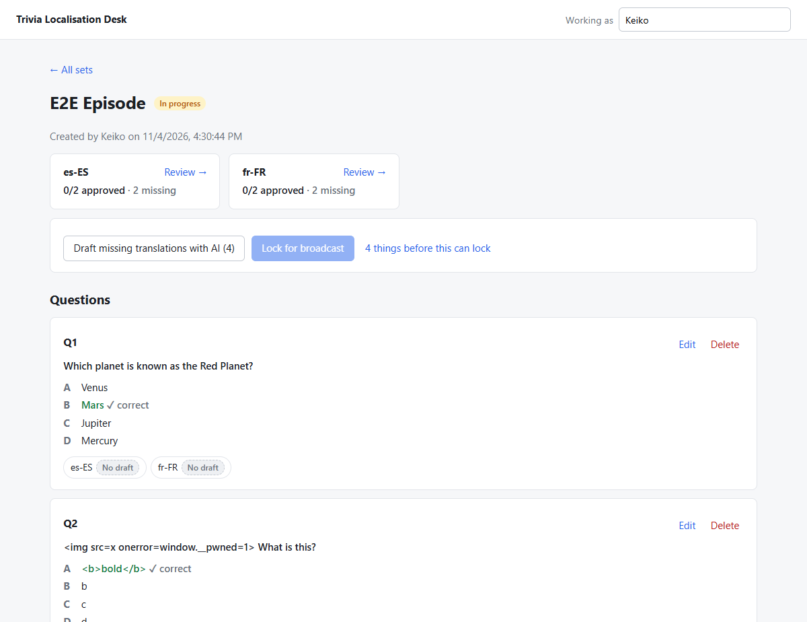
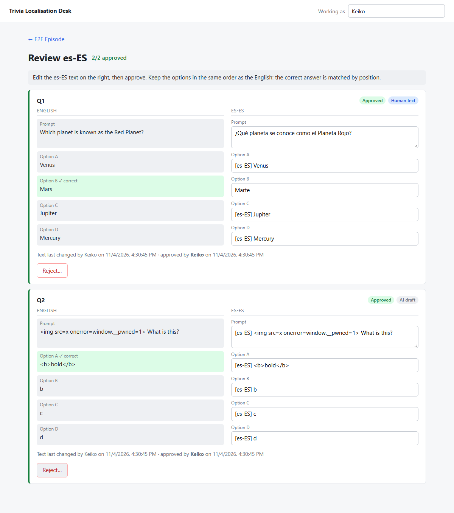

# Trivia Localisation Desk

An internal tool for getting live-trivia questions translated, reviewed and locked before broadcast.

- **Producers** create a question set for an episode, choose target locales and add questions
  (prompt, four options, one correct answer).
- The desk **drafts translations with a stand-in AI** for every question in every locale. The real
  model is behind an interface and can be swapped in later.
- **Linguists** review each draft side by side with the English, fix it, and approve or reject it.
- When every question is approved in every locale, a producer **locks the set for broadcast**.
  After that the server refuses every change.

| Producer view | Linguist review |
| --- | --- |
|  |  |

## Running it

Requirements: Python 3.12+ with [uv](https://docs.astral.sh/uv/), Node 20+.

```bash
# 1. Backend (API on http://localhost:8000)
cd backend
uv sync
uv run python -m app.seed          # optional: a sample episode with mixed review states
uv run uvicorn app.main:app --port 8000

# 2. Frontend (dev server on http://localhost:5173, proxies /api to the backend)
cd frontend
npm install
npm run dev
```

Open http://localhost:5173, type your name in the top-right box, and go.

To run it as one process, build the frontend and the backend will serve it at http://localhost:8000:

```bash
cd frontend && npm run build
cd ../backend && uv run uvicorn app.main:app --port 8000
```

Tests (51, a few seconds):

```bash
cd backend && uv run pytest
cd frontend && npm run typecheck
```

Configuration is by environment variable: `TLD_DB_PATH` (SQLite file, default `backend/data/trivia.db`),
`TLD_TRANSLATOR` (default `pseudo`), `TLD_CORS_ORIGINS`.

## How it works

```
frontend/   React + TypeScript (Vite). Three pages: sets, one set (producer), review one locale (linguist).
backend/
  app/translator.py   The AI boundary: Translator protocol, PseudoTranslator stand-in, parse_draft validator.
  app/service.py      Desk: every domain rule (validation, approval, readiness, locking, audit).
  app/api.py          FastAPI routes; thin. Maps domain errors to 404 / 409 / 422.
  app/schemas.py      Pydantic request/response models.
  app/db.py           SQLite schema. Four tables: question_sets, questions, translations, events.
  tests/              API tests through the HTTP layer, plus validator tests.
```

The API (all under `/api`; interactive docs at http://localhost:8000/docs):

| Method | Path | Does |
| --- | --- | --- |
| `POST` | `/sets` | Create a set: title, locales, `created_by` |
| `GET` | `/sets`, `/sets/{id}` | List; full detail with questions, translations and readiness |
| `POST` | `/sets/{id}/questions` | Add a question |
| `PUT` / `DELETE` | `/questions/{id}` | Edit (sends its translations back to draft) / delete |
| `POST` | `/sets/{id}/drafts` | Draft every missing translation with the AI. Optional `locales`, `overwrite_drafts` |
| `PUT` | `/translations/{id}` | Linguist edits the text. Becomes a human draft that still needs approval |
| `POST` | `/translations/{id}/approve` | Approve, by a named reviewer |
| `POST` | `/translations/{id}/reject` | Reject, by a named reviewer, with a note |
| `POST` | `/sets/{id}/lock` | Lock for broadcast. Refused with the list of blockers unless everything is approved |
| `GET` | `/sets/{id}/events` | Audit trail |

## What I decided and why

The thing the team said they can't have is a wrong or untranslated question going to air. So I spent
the time on a short end-to-end flow with guardrails the server enforces, rather than breadth.

**The AI only sees question text.** `Translator.translate` takes a `SourceQuestion` that has exactly two
fields, prompt and options, plus the target locale. No episode title, no author, no reviewer names, no
ids. When someone swaps in a real vendor, that is all the vendor receives. A test pins this down.

**Model output is untrusted.** Everything the translator returns goes through `parse_draft` before it is
stored: it must be an object with a text prompt and exactly four non-empty, distinct options, within
length limits, with control and zero-width characters stripped. Bad output is not stored; the pair
stays "missing", the failure is recorded in the audit log with the reason, and the producer sees it in
the draft summary. A translator that raises is handled the same way, so one bad call does not abort a
run. The same validator runs on human edits and again at approval time, so every piece of stored text
has passed one check. HTML or script in a draft is kept as text, not rejected: React escapes it, the
linguist sees it literally and fixes it. The end-to-end run in the review screenshot above shows exactly
that.

**A named human approves every translation, and the server checks.** `approve` requires a reviewer
name. `lock` recomputes readiness inside a write transaction and refuses with a list of what is missing,
still in draft, or rejected. The UI greys the button out too, but the UI is not the guard.

**Human text is never overwritten by the machine.** Re-running drafts skips anything that exists. With
`overwrite_drafts`, only untouched AI output (draft or rejected, never human-edited, never approved) is
replaced.

**Editing resets approval.** When a linguist edits a translation it becomes a human draft that must be
approved explicitly. When a producer changes the English prompt or options, every translation of that
question goes back to draft with a note saying why. Changing only which option is correct does not,
because the translated text has not changed.

**Options keep their order.** The correct answer is carried by position, so the linguist never retypes
"which one is right" and cannot get it wrong. The review page says so, and the English correct answer
is highlighted next to the matching field.

**Who did what, and where the text came from.** No auth yet, so names are self-reported, but every
mutation requires one and records it. Each translation carries `source` (`ai` or `human`) for its current
text, plus `reviewed_by` / `reviewed_at` / `review_note`. The `events` table records every action with
actor, locale, source and a detail string, and the producer page shows it.

**Locked is locked.** Every mutating path calls `_require_unlocked` inside its transaction. A test hits
each endpoint on a locked set and checks for 409 and no change.

**Stale reviews are refused.** Each translation has a version. The UI sends the version it loaded with
every edit, approval or rejection, and the server returns 409 if someone else changed it first.

**Readiness is computed, not stored.** "Ready" is derived from the translations every time, per locale
and overall, so it can never drift from the data.

**SQLite, one connection per request, explicit transactions.** Zero setup for an internal tool and plenty
for this load. `BEGIN IMMEDIATE` takes the write lock before check-then-write sequences such as lock,
so two producers cannot both pass the readiness check.

**The pseudo translator tags every string with the locale** (`[es-ES] Mars`) so a draft can never be
mistaken for a reviewed translation and an untranslated string is obvious at a glance.

## Questions I would ask

- **Dana:** Should a set be lockable per locale, so one market can go to air while another is still in
  review? Do producers ever need to add a locale after questions exist?
- **Keiko:** Do linguists work one locale at a time (the current review page) or one question across
  all locales? Should a rejected draft be re-drafted automatically, and does a reject need a reason
  category rather than free text? Are there locale-specific constraints (character limits on the TV
  overlay for Japanese, for example) that should be validated?
- **Marcus:** What does the real model integration look like: one call per question, batched per set,
  async with a queue? That decides whether drafting should become a background job with progress.

## What I would do next

1. **Auth and roles.** Replace self-reported names with SSO identities; producer vs linguist permissions
   (only linguists approve, only producers lock), and "cannot approve your own edit" if the team wants it.
2. **Real translator.** Implement `Translator` against the chosen model with retries, timeouts and a
   per-call cost/latency log; move drafting to a background job with progress in the UI. Keep
   `parse_draft` in front of it unchanged.
3. **Unlock with a reason**, recorded in the audit log, for the inevitable last-minute correction.
4. **Export** of a locked set in whatever shape the broadcast and phone clients need, and a hash so the
   downstream system can prove it has the locked version.
5. **Translation memory.** Suggest previously approved translations for repeated options
   ("True", "False", country names).
6. **Browser tests in the repo.** The flow was verified end to end with Playwright against the built app
   (create set, add questions, draft, edit, approve, reject, lock, read-only after lock, HTML shown as
   text, no console errors); that script should live in the repo with CI.
7. **Operational basics:** request logging, DB backups, migrations once the schema changes.
